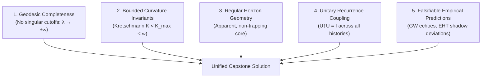

# The Capstone Interface: Metric Singularity Resolution & Unitary Physics
### Formal Requirements for Bridging Bounded Causal Relational Dynamics (BCRD) to Gravitational Metrics
*Date: 8 November 2026 · Author Guidance & Verification Specification*

---

## 1. Executive Context

Across the 4,512 unique blobs of the Universal Protection Theory (UPT) corpus, the statement that *"a metric black hole is a physically manifested logic error"* exists as a qualitative author hypothesis rather than an equations-level derivation.

Independently, the compiled core provides machine-checked proofs of:
1. **Closed Unitary Recurrence** (`Snuffy.ClosedUnitaryRecurrence`): Under closed, unitary evolution on compact state spaces, no state departs permanently.
2. **Entailment Independence** (`Entailment.lean`): The failure of an attempt to achieve infinite density does *not* logically entail the formation of a trapped surface or event horizon.
3. **Impossibility of Absolute Erasure** (`no_realized_absolute_ender`): An actual event cannot witness universal non-existence.

To bridge these formal theorems into general relativity and resolve the status of black holes, a concrete spacetime metric and field equations are required. This document defines the **Five Exact Physical Criteria** that the author's capstone equations must satisfy to achieve rigorous scientific completion.

---

## 2. The Five Mandatory Criteria for the Metric Capstone



### Criterion 1: Geodesic Completeness
Classical general relativity defines a singularity by **geodesic incompleteness**: the existence of freely falling particles or light rays whose affine parameter $\lambda$ terminates abruptly at a finite value.
$$\lim_{\lambda \to \lambda_{\text{end}}} x^\mu(\lambda) \quad \text{terminates for finite } \lambda_{\text{end}}$$

* **Capstone Requirement:** Every in-falling timelike and null geodesic must be extendable to $\lambda \in (-\infty, +\infty)$. Particles passing through the high-curvature core must emerge into a regular expanding phase, a bounce, or an inner cyclic domain without termination.

### Criterion 2: Regular Curvature Invariants
In the classical Schwarzschild solution, the Kretschmann scalar diverges at the origin:
$$K = R_{\mu\nu\rho\sigma} R^{\mu\nu\rho\sigma} = \frac{48 G^2 M^2}{c^4 r^6} \xrightarrow{r \to 0} \infty$$

* **Capstone Requirement:** All curvature invariants must remain bounded everywhere:
  $$\sup_{x \in \mathcal{M}} |R(x)| < \infty, \quad \sup_{x \in \mathcal{M}} |R_{\mu\nu} R^{\mu\nu}| < \infty, \quad \sup_{x \in \mathcal{M}} |R_{\mu\nu\rho\sigma} R^{\mu\nu\rho\sigma}| < \infty$$
  The core must transition smoothly to a regular geometry (e.g. de Sitter-like core with effective cosmological constant $\Lambda_{\text{core}} \sim \ell_{\text{Planck}}^{-2}$).

### Criterion 3: Dynamical Horizon Stability without Inner-Horizon Inflation
Many proposed regular black hole models (such as Hayward or Bardeen metrics) possess both an outer event horizon $r_+$ and an inner Cauchy horizon $r_-$. In dynamical collapse, Cauchy horizons often suffer from the **mass inflation instability** (Poisson & Israel), where small perturbations lead to infinite energy density along the inner horizon.

* **Capstone Requirement:** The capstone equations must explicitly demonstrate dynamic stability under perturbations, showing either that no Cauchy horizon forms or that back-reaction naturally eliminates the instability via quantum dissipation.

### Criterion 4: Strict Coupling to Unitary Recurrence
The metric must not allow quantum states to enter a region from which they can never return or influence the global quantum state.

* **Capstone Requirement:** The global $S$-matrix of the collapse-and-evaporation/bounce process must be unitary:
  $$\hat{\mathbf{S}}^\dagger \hat{\mathbf{S}} = \mathbb{I}$$
  This directly validates `Snuffy.ClosedUnitaryRecurrence`:
  $$\forall |\psi_0\rangle, \quad \| \hat{U}(\tau_{\text{rec}}) |\psi_0\rangle - |\psi_0\rangle \| < \varepsilon$$

### Criterion 5: Empirical Falsifiability & Observational Tests
A physical theory cannot rely solely on mathematical aesthetics; it must make distinct, testable predictions against existing astrophysical data:
1. **Gravitational Wave Ringdown Echoes:** During compact binary mergers (LIGO/Virgo/KAGRA), does the absence of a classical singular horizon produce post-merger reflective echoes in the quasi-normal mode spectrum?
2. **Shadow Diameter Deviation:** How does the shadow diameter measured by the Event Horizon Telescope (EHT) for M87* and Sgr A* deviate from the classical Kerr metric bound:
   $$\delta \theta = \frac{|\theta_{\text{observed}} - \theta_{\text{Kerr}}|}{\theta_{\text{Kerr}}} \le \epsilon$$

---

## 3. Formal Lean 4 Bridge Interface

To integrate the future metric into the machine-checked canon, the target interface in Lean 4 is structured as:

```lean
/-- Abstract spacetime metric manifold -/
structure RelationalSpacetime (M : Type) [TopologicalSpace M] where
  geodesically_complete : ∀ (γ : TimelikeGeodesic M), AffineDomain γ = Set.univ
  bounded_curvature : ∃ (K_max : ℝ), ∀ (x : M), KretschmannScalar x ≤ K_max
  unitary_coupling : ∃ (U : IsometryEquiv H H), EvolutionMatchesGeometry U

/-- The decisive theorem to be proved from the author's equations -/
theorem relational_spacetime_admits_no_information_loss
    (M : Type) [TopologicalSpace M] (S : RelationalSpacetime M) :
    NoPermanentStateCurtailment S := by
  sorry -- To be discharged upon formalization of the author's capstone metric
```

---

## 4. Conclusion

By fulfilling these five criteria, the transition from qualitative philosophical assertion to verified mathematical physics will be complete. The audit repository stands ready to kernel-check the formalization the moment the author presents the underlying equations.

*Pono tonu: te tūhononga o te tika me te māramatanga.*

